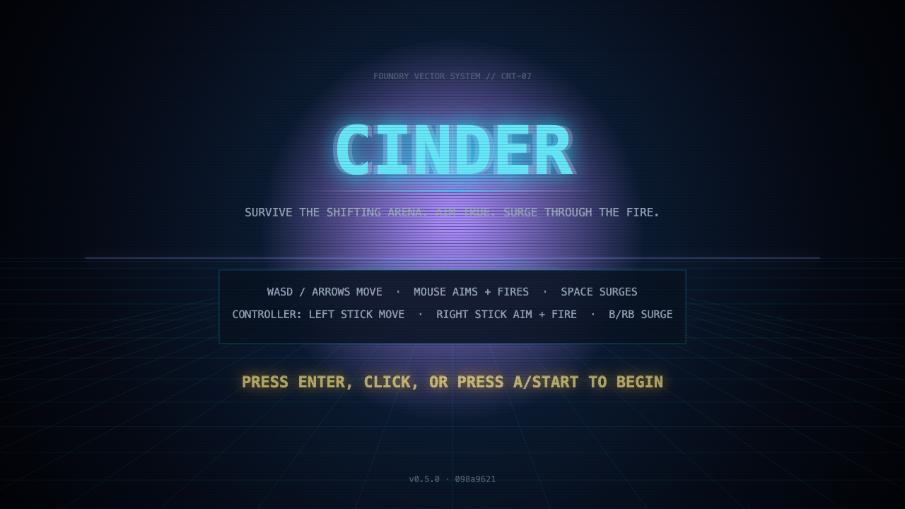
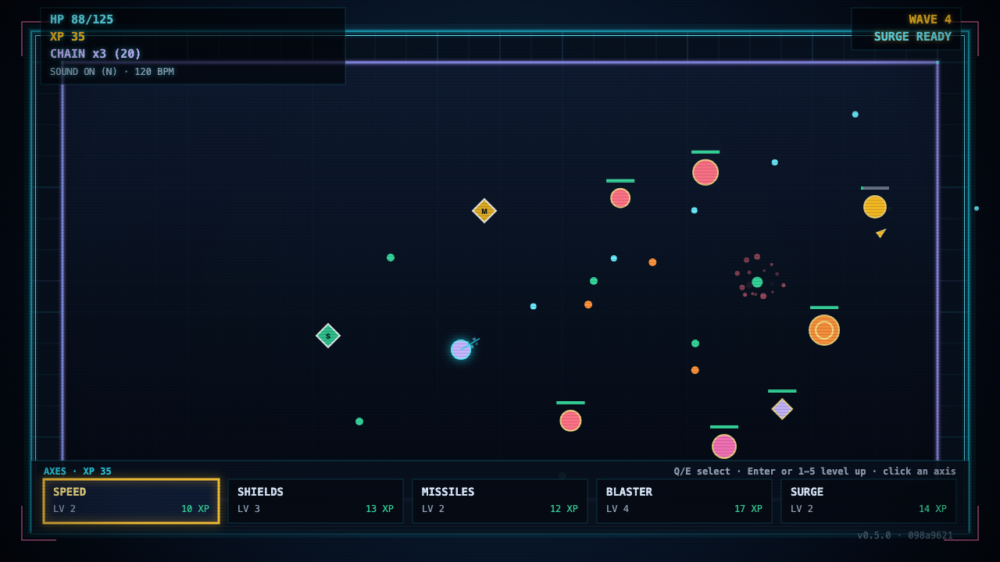
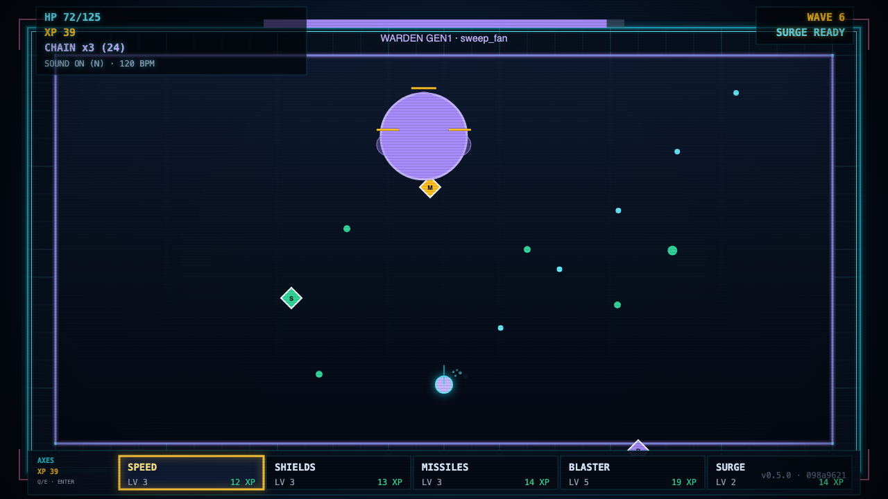

# Cinder

A browser-based twin-stick shooter vertical slice set in the Foundry. Move, aim,
fire, and Surge through escalating enemy waves in a shape-shifting arena, then
fight through two stages and defeat both the Warden and Forgeheart bosses.

## Screenshots



*The title screen.*



*Combat in the Foundry arena, with enemy spawn warnings, XP pickups, power-ups, and the upgrade axis HUD.*



*The Warden boss fight.*

## Quick start

Requirements: [Bun](https://bun.sh/) 1.4+.

```bash
bun install
bun run dev
```

Open **http://localhost:4173/** in a modern browser. The title screen appears
first; press `Enter`, click, or press controller `A`/`Start` to begin. Click the
canvas if keyboard or mouse input does not appear to focus.

To build the production bundle:

```bash
bun run build
```

### Docker deployment

Build and run the production bundle behind Nginx:

```bash
docker compose up --build -d
```

The game is then available at **http://localhost:8787/**. Override the host port
with `CINDER_PORT`, for example `CINDER_PORT=9000 docker compose up --build -d`.
Stop the deployment with `docker compose down`.

### Docker Hub CI/CD

The `CI` GitHub Actions workflow verifies every pull request and push. After a
successful verification of a `v*` release tag, it builds and publishes the
production image to Docker Hub as:

```text
docker.io/<DOCKERHUB_USERNAME>/cinder
```

Published tags include semantic version tags such as `0.8.0` and `0.8`, plus
the commit SHA (`sha-*`). Branch pushes and pull requests are verified but never
log in to or push to Docker Hub.

Configure these GitHub Actions repository secrets before publishing:

- `DOCKERHUB_USERNAME` — Docker Hub account or organization name.
- `DOCKERHUB_TOKEN` — Docker Hub access token with read/write permission.

The workflow can also be run manually from **Actions → CI → Run workflow**
for verification; manual runs do not publish a Docker image.

## Controls

| Action | Input |
| --- | --- |
| Move | `W`, `A`, `S`, `D` or arrow keys |
| Aim | Move the mouse |
| Fire | Hold the left mouse button |
| Surge | `Space` |
| Select axis | `Q` / `E` or D-pad left/right |
| Level selected axis | Controller `A`, `Enter`, `1`-`5`, or click an axis |
| Toggle reduced motion | `M` |
| Toggle sound | `N` |
| Restart run | `R` |

### Controller

Standard-mapping gamepads are supported.

| Action | Input |
| --- | --- |
| Move | Left stick or D-pad |
| Aim / Fire | Right stick (fires automatically while aiming) |
| Surge | `B` or right bumper |
| Select axis | D-pad left/right |
| Level selected axis | `A` |
| Restart run | `Start` |

## How to play

Press `Enter`, click, or press controller `A`/`Start` on the title screen to begin.

1. **Survive the waves.** Each main wave is split into three mini-waves.
   Enemies spawn at warned points inside the arena; a pulsing ring and `!`
   marker show each spawn point before the enemy becomes active. Clear the
   current mini-wave to trigger the next group after a short beat. Clearing the
   final mini-wave starts a 4.5-second breathing break with a countdown before
   the next main wave arrives.
2. **Collect green XP pickups.** Defeated enemies drop XP tokens. Use them at
   any time to level one of five fixed axes: Speed, Shields, Missiles, Blaster,
   or Surge. Selecting an axis and pressing controller `A` levels it
   immediately without pausing the fight. Costs rise with each level; Speed is
   cheapest and Surge is most expensive.
3. **Grab diamond power-ups.** The first enemy you kill drops a missile pickup,
   and every fourth kill drops another random power-up. Power-ups immediately
   level their matching axis (or repair health) at no XP cost. Colored diamonds
   are drawn in the arena and drift toward you when nearby.
4. **Use Surge to escape and attack.** Surge dashes you forward with temporary
   invulnerability and damages nearby enemies. It has a cooldown, and killing
   enemies with it partially refunds that cooldown.
5. **Watch the arena.** Periodically the arena changes shape. An orange outline,
   expanding ring, and fill telegraph the incoming layout. Keep moving so you
   are not caught outside the new safe area.
6. **Build your run.** Bank XP and collect power-ups across the run. Speed
   improves movement, Shields add durability, Missiles add an extra
   auto-firing projectile per level, Blaster improves primary fire, and Surge
   improves your dash and explosion.
7. **Defeat the Warden.** After the early waves, a five-second **WARDEN
   INCOMING** announcement marks the boss arrival point before the Warden
   spawns. Damage routes to exposed weak-point modules while they are
   vulnerable. Destroy the modules to remove the boss's core armour, then
   finish the core.
8. **Push into stage 2.** Defeating the stage-one boss does not end the run.
   A short stage transition leads into a second five-wave block and the
   **FORGEHEART** boss encounter. The run is won only after Forgeheart falls.

## Enemy roster

- **Drone** — basic chaser.
- **Runner** — fast, fragile chaser.
- **Orbiter** — circles the player at range.
- **Charger** — accelerates into close-range contact attacks.
- **Turret** — stationary single-shot ranged enemy.
- **Spinner** — drifting ring-burst enemy.
- **Splitter** — splits into drones when destroyed.
- **Lancer** — fast, precise ranged enemy.
- **Weaver** — fast zig-zagging melee enemy that is hard to track.
- **Bomber** — armoured enemy that fires a radial eight-shot burst when close.
- **Sentinel** — stage-two mid-range enemy that advances deliberately and
  fires an aimed three-shot spread.
- **Mortar** — stage-two artillery enemy that keeps its distance and fires a
  slow three-shot fan.
- **Juggernaut** — stage-two heavy bruiser with a close-range ten-shot radial
  burst and a punishing charge.

## HUD guide

- **HP** — your current and maximum health.
- **XP** — progress toward the next upgrade offer.
- **Axes** — your current Speed, Shields, Missiles, Blaster, and Surge levels.
- **Chain** — your current kill-chain multiplier and kill count. Taking damage
  or letting the chain timer expire resets it.
- **Wave** — current wave number and mini-wave progress (for example,
  `WAVE 3 · 2/3`).
- **WAVE CLEAR** — a countdown and progress bar showing the remaining
  breathing room before the next wave.
- **MINI WAVE** — a brief countdown between enemy groups in the same wave.
- **Surge** — `Ready` or the remaining cooldown in milliseconds.
- **BOSS INCOMING** — a pulsing arena marker, countdown, and progress bar
  shown before the Warden or Forgeheart boss spawns.
- **BOSS NAME / GEN / WEAK POINT** — the current boss identity, generation,
  and exposed module(s).

## Audio and effects

- Combat events have dedicated synthesized sounds: primary fire, missile
  volleys, enemy hits and deaths, player damage, Surge, XP and power-up pickups,
  wave clears/starts, boss warnings, phase changes, module breaks, arena
  mutations, upgrades, victory, and defeat.
- Event-driven particle bursts highlight impacts, deaths, pickups, missile
  launches, Surge dashes, boss damage, and arena mutations. The effect pool is
  capped at 1,800 particles.
- Screen feedback includes camera shake for impactful hits, brief damage and
  power-up color flashes, and a pulsing low-health vignette.

## Difficulty, stages, and boss generations

The simulation supports easy, normal, and hard difficulty tiers across a
two-stage campaign. Stage one uses the Warden; hard runs face its Generation 2
variant with a larger health pool and denser attack patterns. Stage two ends
with the dedicated Forgeheart boss. Difficulty, stage pacing, and boss data are
authored in `src/data/`.

## Troubleshooting

- **Blank page:** make sure you are opening the URL printed by Vite, normally
  `http://localhost:4173/`, and hard-refresh the page.
- **Testing from another device:** use the Network URL printed by Vite. The game
  no longer depends on `crypto.randomUUID`, so plain-HTTP LAN origins work.
- **Canvas is larger than the window:** the game canvas is fixed at 1280x720;
  zoom out or use a larger window to see the whole arena.
- **Input does not respond:** click the canvas once, then use the keyboard and
  mouse again.
- **No sound:** press `N` to check whether sound is muted. Browsers require a
  click or key press before audio can start; the first input unlocks sound.
- **Music:** the procedural soundtrack runs at 120 BPM on a grid synchronized
  to the 60 Hz simulation. Wave arrangements add higher arpeggios and rhythmic
  variation as the run progresses, while the Warden fight switches to a
  distinct driving bass progression and lead phrase. It pauses when the
  simulation is paused.

## Development checks

```bash
bun run test       # unit, simulation, and feel tests
bun run verify     # lint, typecheck, tests, replay, soak, latency, build
bun run perf:frame # frame-budget smoke check
```

Agent and contributor workflow details are in [`agent.md`](agent.md).

Simulation code lives in `src/sim/` and is deterministic and renderer-free.
Rendering, HUD, audio, telemetry, and tuning data are kept in their own
directories. Sound effects are synthesized at runtime with the Web Audio API,
so no external audio assets are required.

The HUD shows the release version, Git commit, and CI build number. Production
builds also emit `dist/build-info.json`, and CI uploads the full `dist/`
directory as a versioned artifact.
